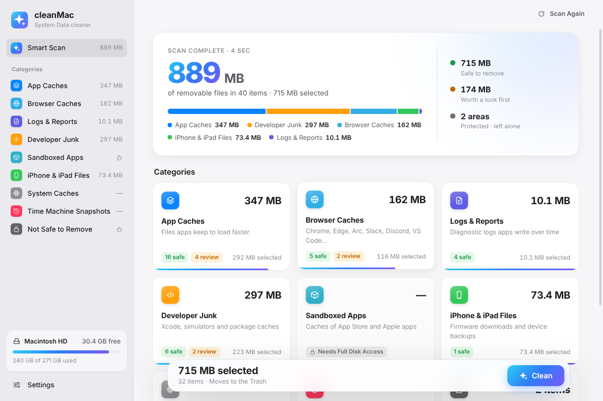
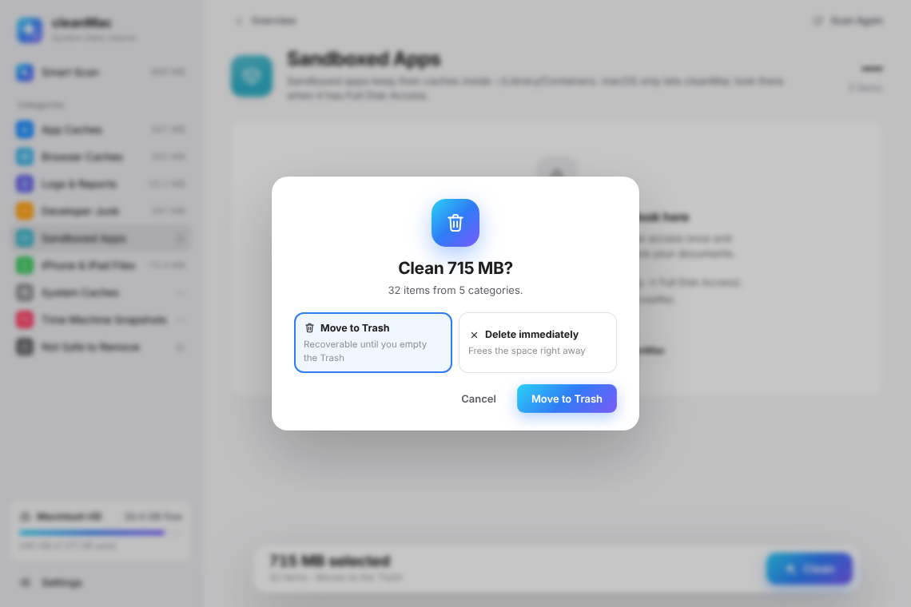

<p align="center">
  
</p>

<h1 align="center">cleanMac</h1>

<p align="center">
  Review the space macOS calls <b>“System Data”</b> — app caches, logs, browser caches and developer leftovers — and uninstall apps with Deep Delete.<br>
  Built on your own Mac, runs offline, and leaves no trace when you delete it.
</p>

<p align="center">
  
</p>
<p align="center">
  
  
</p>
<p align="center"><sub>On macOS the sidebar is translucent and the interface uses the system font.</sub></p>

---

## Install

You need **macOS 13 Ventura or newer** and about **500 MB** of free space while building (about 280 MB afterwards).
Nothing else — no Xcode, no Homebrew, no Node.js.

**With git** (recommended):

```bash
git clone https://github.com/zhengzihao2002/cleanMac.git ~/cleanMac
cd ~/cleanMac
./build.sh
```

**Without git:** click **Code → Download ZIP** on GitHub, unzip it, move the folder into your home folder
(for example `~/cleanMac`), then in Terminal:

```bash
cd ~/cleanMac      # wherever you put the folder
bash build.sh
```

The build takes about a minute. When it finishes, **`cleanMac.app` appears in the project folder** and opens.
From then on just double-click `cleanMac.app` (you can drag it to the Dock, but leave the app itself in the folder).

> **Why the home folder?** macOS asks for permission whenever an app touches Desktop, Documents or Downloads.
> cleanMac works from there too, but keeping the folder in your home folder avoids those prompts.

### Why do I build it myself?

macOS blocks apps downloaded from the internet unless the developer pays Apple to notarize them. Instead of asking you
to bypass Gatekeeper, `build.sh` assembles the app **on your Mac**:

1. Downloads the Electron runtime (the same open-source engine behind VS Code and Slack) from its official GitHub release,
   pinned to an exact version, into `.runtime/` inside this folder.
2. Verifies the download against a **SHA-256 checksum written in `build.sh`** — a corrupted or tampered file is rejected.
3. Puts cleanMac’s source code (the `src/` folder you can read) into the app and gives it its name and icon.
4. Signs the app **ad-hoc for this Mac only** with Apple’s built-in `codesign` tool.

No account, no `sudo`, nothing installed outside the folder.

| Command                      | What it does                                        |
| ---------------------------- | --------------------------------------------------- |
| `./build.sh`                 | Build `cleanMac.app` and open it                     |
| `./build.sh --no-open`       | Build only                                           |
| `./build.sh --keep-download` | Keep the runtime download for faster rebuilds        |
| `./build.sh --clean`         | Remove everything the build created                  |
| `./uninstall.sh`             | Clear macOS’s records of cleanMac, then trash the folder |

---

## What it cleans

### Updating from Settings

Click **Settings → Check for Updates** to compare the installed build's source commit with this repository's default
branch on GitHub. Matching commits display **Already up to date** without downloading source, building or relaunching.
Update progress changes only the button and status text in Settings. Navigation retains screen scroll positions and
search filters, without replaying a full-screen fade or scrolling back to the top.
If a new commit exists, cleanMac downloads that exact revision, downloads the build runtime if needed, builds and signs
a fresh app. It quits, replaces `cleanMac.app` in the original project folder, then opens that same app path automatically.
No Terminal commands or Git installation are needed for updates. Unknown source revisions produce a clear error without
downloading or rebuilding.

Updates build temporarily inside the original project's `.runtime/updates` folder. A rollback copy stays in
`.runtime/update-backups` during installation. After the updated interface starts successfully, it removes old update
folders and rollback copies, while preserving any copy still running. Previous updater versions' hidden app copies are
automatically moved back to the original app location, then cleaned up. Everything stays in the original cleanMac folder;
local source edits and unrelated files are preserved. Failed installation restores the previous app. An older GitHub version is refused.
This button downloads the published GitHub source; local changes must be published there before they can be fetched.

Cleanup remains offline. Explicitly requested updates use HTTPS to GitHub and the runtime download hosts; there is no
background update polling or tracking. The interface itself still blocks network requests.

**Smart Scan** only looks at a **fixed list of locations**. Your documents, photos, mail, passwords and app settings
are excluded from that cleanup. **Deep Delete** is a separate, explicit app-uninstall workflow described below.

| Category | Where | Notes |
| --- | --- | --- |
| **App Caches** | `~/Library/Caches/*` | Rebuilt automatically by each app. |
| **Browser Caches** | Chromium/Electron caches in `~/Library/Application Support` (Chrome, Edge, Brave, Arc, Slack, Discord, VS Code, Teams, Notion…) | Only folders that *look like* Chromium caches (`Cache`, `Code Cache`, `GPUCache`, …) **and** contain Chromium’s cache files. Profiles, history, cookies and passwords are never touched. |
| **Logs & Reports** | `~/Library/Logs` | Diagnostic logs and crash reports. |
| **Developer Junk** | Xcode DerivedData, device support files, simulator caches, npm/Yarn/Bun/pip/Cargo/Gradle/Go caches… | Rebuilt or re-downloaded by the tools. |
| **Sandboxed Apps** | `~/Library/Containers/*/Data/Library/Caches`, group container caches, Mail attachment copies | Needs Full Disk Access (optional). |
| **iPhone & iPad Files** | Downloaded `.ipsw` firmware, local device backups | Backups are *Review* only. |
| **System Caches** | `/Library/Caches`, `/Library/Logs`, rotated logs in `/private/var/log` | Asks for your administrator password; deleted directly. |
| **Time Machine Snapshots** | Local snapshots on your startup disk | *Review* only; deleted with `tmutil`. |
| **Not Safe to Remove** | Swap & sleep image, temporary files of running apps, unified logs, Mail, Messages, Docker disk image… | **Shown for transparency, never removed.** |

### How it decides what is safe

Every item gets one of three ratings, and the reason is one click away (ⓘ) in the app:

- 🟢 **Safe** — macOS or the owning app rebuilds it automatically. Selected for you.
- 🟠 **Review** — removable, but with a side effect: a large re-download (Playwright browsers, Hugging Face models,
  Maven repository), a re-sync with iCloud (`com.apple.bird`, `CloudKit`), lost in-progress downloads, an Xcode archive
  you might need, or a device backup. **Never selected for you.**
- 🔒 **Protected** — part of System Data that is your data or that macOS needs while running. Listed so you know where
  the space goes; cleanMac refuses to remove it.

Items owned by an app that is **currently running** are marked *Open* and not selected. Cleanup checks running apps
again and skips their files — quit the owning app before retrying.

### Deep Delete

Open **Deep Delete** in the sidebar, choose an installed application, then review its application bundle and the related
files found in known Library locations. Only the app bundle is selected initially. Caches, logs, preferences,
application support data, saved state, web data and sandbox containers must each be selected explicitly: they may
contain settings, sign-ins or saved work. You can reveal individual items in Finder and refresh the preview.

Apps display their native macOS icons when available. The list initially shows only apps ready for removal, sorted
alphabetically. **Show unavailable apps** reveals open apps and protected apps in separate groups below removable apps.
Open apps must be quit before removal; protected apps remain locked.
Bundle ICNS files are converted with macOS's `sips` tool into PNGs cached inside `.runtime/icons`, with the native file
icon API as a fallback. Permission relaunches explicitly open the original `cleanMac.app` path after the process exits.

Deep Delete matches **exact bundle identifiers**, including well-formed device-specific preference names, plus an
explicit list of app-specific support folders for Chrome, Edge, Brave, Slack, Discord and Visual Studio Code. For example,
Chrome can include `~/Library/Application Support/Google/Chrome`, while leaving sibling Google folders alone. These
support folders also start unchecked. It does not guess based on an app's display name or delete a vendor's entire folder.
Apple/system apps and cleanMac itself are
protected. Shared Group Containers, privileged helpers, launch agents and personal folders outside the app's private
data are excluded. If another discovered installed copy uses the same identifier, related data is excluded to protect it.

Before each move, cleanMac checks the app's identity, selected file identity, symlink ancestry and running processes
again. Changed files are left in place. Incomplete previews cannot be selected. If a selected related file fails,
the app stays installed so you can resolve the problem and retry. Permission failures are reported without escalating
Deep Delete to administrator access.

**Deep Delete always moves files to Trash**, regardless of the Smart Scan setting. Review the result and empty Trash
yourself when ready; until then, you can restore the moved files. Moving files to Trash does not itself free disk space.
Apps can write data anywhere, and macOS snapshots or shared files can retain space, so this feature cannot guarantee
the exact free-space figure you had before installing an app.

### Defence in depth

Deleting the wrong thing is the one mistake a cleaner must never make, so safety does not rely on any single check:

1. **Allow-list scanning.** Only the locations above are read. Folders that are symbolic links are skipped.
2. **Signature checks.** A folder named `Cache` inside Application Support is only offered if it contains Chromium’s
   cache files (`Cache_Data`, `index`, `js/`…).
3. **The interface never names paths.** It can only send the ids of items the scanner produced.
4. **An independent Smart Scan deletion guard** (`src/main/guard.js`) re-checks every single path right before removal: it must
   match the allow-list, must not match the deny-list (Keychains, Preferences, Mail, Messages, iCloud Drive, Photos,
   installed app bundles, `/System`, …), must not travel through a symbolic link, and must not belong to cleanMac itself.
   Rebuildable app bundles inside explicitly declared Xcode build/preview locations and Playwright/Cypress browser
   caches remain cleanable; unrelated updater bundles are protected.
   Directory contents are checked recursively so a protected descendant cannot be removed through its parent.
   Scans retain root file identities; a replaced root is skipped. Deep Delete has a separate narrow app-uninstall
   allow-list and private preview identifiers in `src/main/deep-delete.js`.
5. **Contents, not folders.** Cache folders are emptied, not deleted, so apps find them where they expect them.
6. **Trash by default.** Files go to the Trash (with *Put Back*) unless you choose *Delete immediately*.
7. **System items** are removed by a tiny shell script (`src/main/admin-helper.sh`) that runs only after you approve
   macOS’s password dialog, and **re-validates every path itself** — it only accepts `/Library/Caches`,
   `/Library/Logs`, `/private/var/log` and well-formed snapshot names.

### Full Disk Access (optional)

Without it cleanMac still finds most junk. With it, cleanMac can also look inside sandboxed apps’ caches and list device
backups. In the app, open **Settings → Permissions → Open Settings**, click **+**, choose `cleanMac.app` in your
cleanMac folder, switch it on and relaunch cleanMac.

---

## Leaves no trace

Everything cleanMac uses lives inside the project folder:

| What | Where |
| --- | --- |
| The app | `cleanMac/cleanMac.app` |
| The Electron runtime download | `cleanMac/.runtime/downloads` (deleted after the build unless `--keep-download`) |
| Build temp files | `cleanMac/.runtime/tmp` (deleted after the build) |
| Your one setting (Trash vs. delete) | `cleanMac/.runtime/settings.json` |

While it runs, Electron’s working data (normally kept in `~/Library/Application Support`) is redirected to a private
temporary folder that is **erased after the app quits**. cleanMac also:

- uses a mock keychain, so no “cleanMac Safe Storage” keychain item is created,
- blocks all network requests from the interface (the Settings updater explicitly downloads source and runtime through macOS tools),
- after quitting, sweeps the few files macOS creates for *any* app (saved window state, preference domain, per-app
  system caches).

So **deleting the folder removes cleanMac completely.** The only things macOS itself remembers about apps you have
opened are the Full Disk Access entry (if you granted it) and a Launch Services record. To clear those too, run
`./uninstall.sh` before deleting the folder — it also offers to move the folder to the Trash for you.

---

## Development

```
cleanMac/
├── build.sh               # builds cleanMac.app locally
├── uninstall.sh           # removes macOS’s records of cleanMac
├── test.sh                # runs the tests with the Node.js built into the app
├── assets/                # icon (SVG source, PNG, .icns)
├── src/
│   ├── main/              # Electron main process (Node.js)
│   │   ├── main.js        #   window, menu, IPC
│   │   ├── runtime.js     #   “leave no trace” path redirection and exit sweep
│   │   ├── rules.js       #   the safety knowledge base
│   │   ├── categories.js  #   what is scanned
│   │   ├── scanner.js     #   runs collectors, measures sizes
│   │   ├── guard.js       #   independent deletion allow/deny-list
│   │   ├── cleaner.js     #   removal (Trash / delete / admin)
│   │   ├── deep-delete.js #   app discovery, exact-match previews and Trash-only uninstall
│   │   ├── admin-helper.sh#   root helper for system items
│   │   ├── system.js      #   disk, permissions, installed & running apps
│   │   ├── sizer.js       #   disk usage via du
│   │   └── plist.js       #   tiny XML/binary plist reader
│   ├── preload/           # the narrow bridge exposed to the interface
│   └── renderer/          # the interface (HTML, CSS, vanilla JS — no frameworks)
└── test/                  # node:test suites with a fake macOS home folder
```

- **Run the tests:** `./test.sh` (uses the Node.js inside `cleanMac.app`; build first).
- **Debug:** `CLEANMAC_DEBUG=1 ./cleanMac.app/Contents/MacOS/cleanMac` enables the View menu and DevTools.
- **After changing `src/`:** run `./build.sh --keep-download` again.

There are no npm dependencies at all: the interface is plain HTML/CSS/JavaScript and the main process only uses
Node.js built-ins.

## License

MIT
