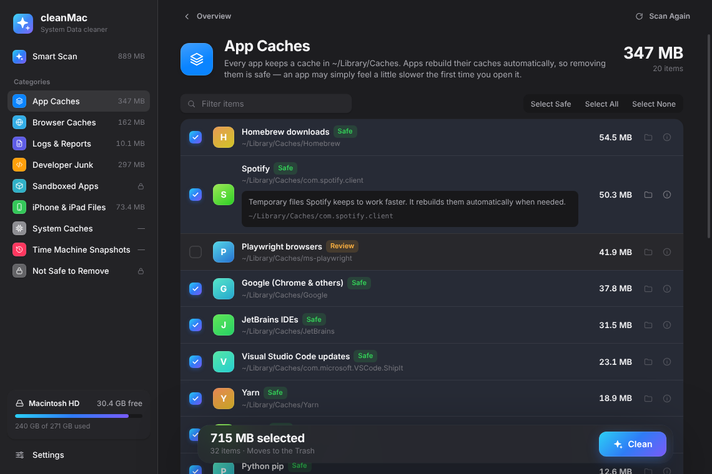

<p align="center">
  
</p>

<h1 align="center">cleanMac</h1>

<p align="center">
  Safely reclaim the space macOS calls <b>“System Data”</b> — app caches, logs, browser caches and developer leftovers.<br>
  Built on your own Mac, runs offline, and leaves no trace when you delete it.
</p>

<p align="center">
  
</p>
<p align="center">
  
  
</p>
<p align="center"><sub>On macOS the sidebar is translucent and the interface uses the system font.</sub></p>

---

## Install

You need **macOS 13 Ventura or newer** and about **500 MB** of free space while building (about 280 MB afterwards).
Nothing else — no Xcode, no Homebrew, no Node.js.

**With git** (recommended):

```bash
git clone https://github.com/zhengzihao2002/cleanMac.git ~/cleanMac
cd ~/cleanMac
./build.sh
```

**Without git:** click **Code → Download ZIP** on GitHub, unzip it, move the folder into your home folder
(for example `~/cleanMac`), then in Terminal:

```bash
cd ~/cleanMac      # wherever you put the folder
bash build.sh
```

The build takes about a minute. When it finishes, **`cleanMac.app` appears in the project folder** and opens.
From then on just double-click `cleanMac.app` (you can drag it to the Dock, but leave the app itself in the folder).

> **Why the home folder?** macOS asks for permission whenever an app touches Desktop, Documents or Downloads.
> cleanMac works from there too, but keeping the folder in your home folder avoids those prompts.

### Why do I build it myself?

macOS blocks apps downloaded from the internet unless the developer pays Apple to notarize them. Instead of asking you
to bypass Gatekeeper, `build.sh` assembles the app **on your Mac**:

1. Downloads the Electron runtime (the same open-source engine behind VS Code and Slack) from its official GitHub release,
   pinned to an exact version, into `.runtime/` inside this folder.
2. Verifies the download against a **SHA-256 checksum written in `build.sh`** — a corrupted or tampered file is rejected.
3. Puts cleanMac’s source code (the `src/` folder you can read) into the app and gives it its name and icon.
4. Signs the app **ad-hoc for this Mac only** with Apple’s built-in `codesign` tool.

No account, no `sudo`, nothing installed outside the folder.

| Command                      | What it does                                        |
| ---------------------------- | --------------------------------------------------- |
| `./build.sh`                 | Build `cleanMac.app` and open it                     |
| `./build.sh --no-open`       | Build only                                           |
| `./build.sh --keep-download` | Keep the runtime download for faster rebuilds        |
| `./build.sh --clean`         | Remove everything the build created                  |
| `./uninstall.sh`             | Clear macOS’s records of cleanMac, then trash the folder |

---

## What it cleans

cleanMac only ever looks at a **fixed list of locations**. Everything else — your documents, photos, mail, passwords,
app settings — is never scanned, let alone removed.

| Category | Where | Notes |
| --- | --- | --- |
| **App Caches** | `~/Library/Caches/*` | Rebuilt automatically by each app. |
| **Browser Caches** | Chromium/Electron caches in `~/Library/Application Support` (Chrome, Edge, Brave, Arc, Slack, Discord, VS Code, Teams, Notion…) | Only folders that *look like* Chromium caches (`Cache`, `Code Cache`, `GPUCache`, …) **and** contain Chromium’s cache files. Profiles, history, cookies and passwords are never touched. |
| **Logs & Reports** | `~/Library/Logs` | Diagnostic logs and crash reports. |
| **Developer Junk** | Xcode DerivedData, device support files, simulator caches, npm/Yarn/Bun/pip/Cargo/Gradle/Go caches… | Rebuilt or re-downloaded by the tools. |
| **Sandboxed Apps** | `~/Library/Containers/*/Data/Library/Caches`, group container caches, Mail attachment copies | Needs Full Disk Access (optional). |
| **iPhone & iPad Files** | Downloaded `.ipsw` firmware, local device backups | Backups are *Review* only. |
| **System Caches** | `/Library/Caches`, `/Library/Logs`, rotated logs in `/private/var/log` | Asks for your administrator password; deleted directly. |
| **Time Machine Snapshots** | Local snapshots on your startup disk | *Review* only; deleted with `tmutil`. |
| **Not Safe to Remove** | Swap & sleep image, temporary files of running apps, unified logs, Mail, Messages, Docker disk image… | **Shown for transparency, never removed.** |

### How it decides what is safe

Every item gets one of three ratings, and the reason is one click away (ⓘ) in the app:

- 🟢 **Safe** — macOS or the owning app rebuilds it automatically. Selected for you.
- 🟠 **Review** — removable, but with a side effect: a large re-download (Playwright browsers, Hugging Face models,
  Maven repository), a re-sync with iCloud (`com.apple.bird`, `CloudKit`), lost in-progress downloads, an Xcode archive
  you might need, or a device backup. **Never selected for you.**
- 🔒 **Protected** — part of System Data that is your data or that macOS needs while running. Listed so you know where
  the space goes; cleanMac refuses to remove it.

Items owned by an app that is **currently running** are marked *Open* and not selected — quit the app first.

### Defence in depth

Deleting the wrong thing is the one mistake a cleaner must never make, so safety does not rely on any single check:

1. **Allow-list scanning.** Only the locations above are read. Folders that are symbolic links are skipped.
2. **Signature checks.** A folder named `Cache` inside Application Support is only offered if it contains Chromium’s
   cache files (`Cache_Data`, `index`, `js/`…).
3. **The interface never names paths.** It can only send the ids of items the scanner produced.
4. **An independent deletion guard** (`src/main/guard.js`) re-checks every single path right before removal: it must
   match the allow-list, must not match the deny-list (Keychains, Preferences, Mail, Messages, iCloud Drive, Photos,
   app bundles, `/System`, …), must not travel through a symbolic link, and must not belong to cleanMac itself.
5. **Contents, not folders.** Cache folders are emptied, not deleted, so apps find them where they expect them.
6. **Trash by default.** Files go to the Trash (with *Put Back*) unless you choose *Delete immediately*.
7. **System items** are removed by a tiny shell script (`src/main/admin-helper.sh`) that runs only after you approve
   macOS’s password dialog, and **re-validates every path itself** — it only accepts `/Library/Caches`,
   `/Library/Logs`, `/private/var/log` and well-formed snapshot names.

### Full Disk Access (optional)

Without it cleanMac still finds most junk. With it, cleanMac can also look inside sandboxed apps’ caches and list device
backups. In the app, open **Settings → Permissions → Open Settings**, click **+**, choose `cleanMac.app` in your
cleanMac folder, switch it on and relaunch cleanMac.

---

## Leaves no trace

Everything cleanMac uses lives inside the project folder:

| What | Where |
| --- | --- |
| The app | `cleanMac/cleanMac.app` |
| The Electron runtime download | `cleanMac/.runtime/downloads` (deleted after the build unless `--keep-download`) |
| Build temp files | `cleanMac/.runtime/tmp` (deleted after the build) |
| Your one setting (Trash vs. delete) | `cleanMac/.runtime/settings.json` |

While it runs, Electron’s working data (normally kept in `~/Library/Application Support`) is redirected to a private
temporary folder that is **erased after the app quits**. cleanMac also:

- uses a mock keychain, so no “cleanMac Safe Storage” keychain item is created,
- blocks all network requests (it never needs the internet),
- after quitting, sweeps the few files macOS creates for *any* app (saved window state, preference domain, per-app
  system caches).

So **deleting the folder removes cleanMac completely.** The only things macOS itself remembers about apps you have
opened are the Full Disk Access entry (if you granted it) and a Launch Services record. To clear those too, run
`./uninstall.sh` before deleting the folder — it also offers to move the folder to the Trash for you.

---

## Development

```
cleanMac/
├── build.sh               # builds cleanMac.app locally
├── uninstall.sh           # removes macOS’s records of cleanMac
├── test.sh                # runs the tests with the Node.js built into the app
├── assets/                # icon (SVG source, PNG, .icns)
├── src/
│   ├── main/              # Electron main process (Node.js)
│   │   ├── main.js        #   window, menu, IPC
│   │   ├── runtime.js     #   “leave no trace” path redirection and exit sweep
│   │   ├── rules.js       #   the safety knowledge base
│   │   ├── categories.js  #   what is scanned
│   │   ├── scanner.js     #   runs collectors, measures sizes
│   │   ├── guard.js       #   independent deletion allow/deny-list
│   │   ├── cleaner.js     #   removal (Trash / delete / admin)
│   │   ├── admin-helper.sh#   root helper for system items
│   │   ├── system.js      #   disk, permissions, installed & running apps
│   │   ├── sizer.js       #   disk usage via du
│   │   └── plist.js       #   tiny XML/binary plist reader
│   ├── preload/           # the narrow bridge exposed to the interface
│   └── renderer/          # the interface (HTML, CSS, vanilla JS — no frameworks)
└── test/                  # node:test suites with a fake macOS home folder
```

- **Run the tests:** `./test.sh` (uses the Node.js inside `cleanMac.app`; build first).
- **Debug:** `CLEANMAC_DEBUG=1 ./cleanMac.app/Contents/MacOS/cleanMac` enables the View menu and DevTools.
- **After changing `src/`:** run `./build.sh --keep-download` again.

There are no npm dependencies at all: the interface is plain HTML/CSS/JavaScript and the main process only uses
Node.js built-ins.

## License

MIT
